# Діаграми основного CLI

## Зміст

1. [Загальний робочий цикл](#diagram-01)
2. [Початкове налаштування](#diagram-02)
3. [Створення збереженого плану](#diagram-03)
4. [Перевірка та застосування плану](#diagram-04)
5. [Відновлення після невдалого оновлення](#diagram-05)
6. [Підписаний HTTP-запит — UML-послідовність](#diagram-06)
7. [Придатність збереженого плану — UML-стани](#diagram-07)
8. [Залежності модулів — структурна UML-модель](#diagram-08)
9. [Ресурси AWS — структурна UML-модель](#diagram-09)
10. [Очищення власного S3-бакета](#diagram-10)
11. [Явний локальний перехід попереднього стану](#diagram-11)

## 1. Загальний робочий цикл

Кожен блок із командами позначає окремі виклики CLI оператором. `config` і
`concurrency` дозволяють перевірити локальні налаштування перед новим планом.
Готовий образ збирає та публікує зовнішній процес. Перехід до наступної операції
передбачає успіх попередньої; відмови деталізовано на наступних схемах.

```mermaid
%%{init: {"theme":"base","themeVariables":{"primaryColor":"#001E62","primaryTextColor":"#FFFFFF","primaryBorderColor":"#001E62","lineColor":"#001E62","textColor":"#001E62","secondaryColor":"#EEF2FA","secondaryTextColor":"#001E62","secondaryBorderColor":"#001E62","tertiaryColor":"#EEF2FA","tertiaryTextColor":"#001E62","tertiaryBorderColor":"#001E62","edgeLabelBackground":"#EEF2FA","labelBackgroundColor":"#EEF2FA"},"themeCSS":".edgeLabel, .edgeLabel p, .edgeLabel span { color: #001E62 !important; fill: #001E62 !important; } .edgeLabel, .labelBkg { background-color: #EEF2FA !important; }"}}%%
flowchart LR
    S(["Нове розгортання"])
    INIT[["Налаштувати область<br/>init"]]
    REG[["Підготувати KMS/ECR<br/>plan registry → apply"]]
    IMAGE[/"Готовий образ у ECR<br/>Зовнішня публікація"/]
    DEPLOY[["Розгорнути образ<br/>plan workload → apply"]]
    OBSERVE[["Перевірити роботу<br/>status / request / logs"]]
    NEXT{"Наступна дія?"}
    ROLLBACK[["Повернути образ<br/>plan rollback → apply"]]
    REMOVE[["Очистити й видалити<br/>cleanup → plan destroy → apply"]]
    E(["Завершити сеанс"])
    S --> INIT --> REG --> IMAGE --> DEPLOY --> OBSERVE --> NEXT
    NEXT -->|Оновити| IMAGE
    NEXT -->|Відновити вручну| ROLLBACK --> OBSERVE
    NEXT -->|Видалити| REMOVE --> E
    NEXT -->|Залишити ресурси| E
```

## 2. Початкове налаштування

Джерела: `main.main`, `Deployment.initialize` і `execute`. Назва та checkout
перевіряються до операції. Підпроцес перевірки налаштувань відхиляє вже
ініціалізоване розгортання, перевіряє формат account/region/profile, наявність AWS CLI
та збіг STS account ID. Новий `init` не створює AWS-ресурсів.

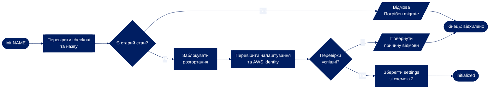

## 3. Створення збереженого плану

Джерела: `Deployment.plan`, `check_plan`, `source_digest`. Дві частини
належать одному виклику `plan`; локальний lock утримується до завершення.
Будь-яка відмова проміжної перевірки зупиняє планування й повертає помилку.

### 3а. Перевірка області та передумов

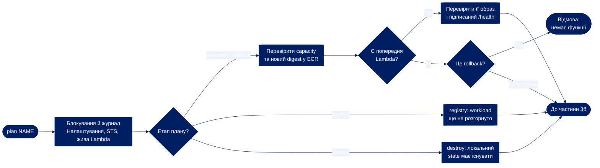

### 3б. Збереження та перевірка плану

```mermaid
%%{init: {"theme":"base","themeVariables":{"primaryColor":"#001E62","primaryTextColor":"#FFFFFF","primaryBorderColor":"#001E62","lineColor":"#001E62","textColor":"#001E62","secondaryColor":"#EEF2FA","secondaryTextColor":"#001E62","secondaryBorderColor":"#001E62","tertiaryColor":"#EEF2FA","tertiaryTextColor":"#001E62","tertiaryBorderColor":"#001E62","edgeLabelBackground":"#EEF2FA","labelBackgroundColor":"#EEF2FA"},"themeCSS":".edgeLabel, .edgeLabel p, .edgeLabel span { color: #001E62 !important; fill: #001E62 !important; } .edgeLabel, .labelBkg { background-color: #EEF2FA !important; }"}}%%
flowchart LR
    S(["Із частини 3а"])
    INIT[["Ініціалізувати Terraform<br/>Локальний backend і lockfile"]]
    INPUTS["Створити plan-id<br/>та inputs.tfvars.json"]
    TF[["Зберегти plan.tfplan<br/>і його TXT/JSON"]]
    POLICY{"Дії й ownership<br/>дозволені?"}
    ERROR[/"Відхилити план<br/>Зберегти докази"/]
    REJECT(["Кінець: помилка"])
    REVIEW["Зберегти review.json<br/>Прив'язки, хеші, строк 1 год"]
    OUT[/"plan-id, SHA-256 review<br/>та шлях до plan.txt"/]
    E(["planned"])
    S --> INIT --> INPUTS --> TF --> POLICY
    POLICY -->|Ні| ERROR --> REJECT
    POLICY -->|Так| REVIEW --> OUT --> E
```

`rollback` без попередньої функції відхиляється. `registry` не може змінювати workload.
`check_plan` відхиляє імпорт, чужі теги/модулі та неявне видалення або заміну
в workload-плані. Для registry додаються targets KMS/ECR, для destroy — `-destroy`.

## 4. Перевірка та застосування плану

Джерела: `Deployment.reviewed` і `Deployment.apply`. Частина 4а завершується
**перед** спробою застосування; частина 4б виконує цю спробу. Прапорець `--yes`
дозволяє саме переглянутий збережений план. Його не перегенеровують під час apply.
Помилки до `applied.json` блокують apply. `DeploymentError` або переривання,
перехоплені всередині apply, спрямовуються до схеми 5.

### 4а. Перегляд, погодження та захист від повтору

```mermaid
%%{init: {"theme":"base","themeVariables":{"primaryColor":"#001E62","primaryTextColor":"#FFFFFF","primaryBorderColor":"#001E62","lineColor":"#001E62","textColor":"#001E62","secondaryColor":"#EEF2FA","secondaryTextColor":"#001E62","secondaryBorderColor":"#001E62","tertiaryColor":"#EEF2FA","tertiaryTextColor":"#001E62","tertiaryBorderColor":"#001E62","edgeLabelBackground":"#EEF2FA","labelBackgroundColor":"#EEF2FA"},"themeCSS":".edgeLabel, .edgeLabel p, .edgeLabel span { color: #001E62 !important; fill: #001E62 !important; } .edgeLabel, .labelBkg { background-color: #EEF2FA !important; }"}}%%
flowchart LR
    S(["apply NAME"])
    I[/"plan-id, SHA-256 review<br/>прапорець --yes"/]
    REVIEW[["Перевірити чинність<br/>і прив'язки плану"]]
    YES{"Передано<br/>--yes?"}
    WAIT[/"Показати повний план<br/>review-required"/]
    STOP(["Кінець: без apply"])
    PRE[["Перевірити AWS і Lambda<br/>Образи та ємність за етапом"]]
    INIT[["Terraform init<br/>Повторно перевірити review"]]
    MARK["Записати applied.json<br/>Спробу використано"]
    E(["До частини 4б"])
    S --> I --> REVIEW --> YES
    YES -->|Ні| WAIT --> STOP
    YES -->|Так| PRE --> INIT --> MARK --> E
```

### 4б. Застосування та оцінка результату

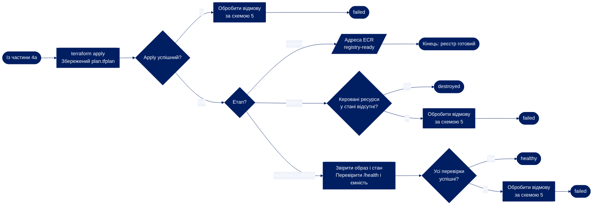

`reviewed` перевіряє ID, схему, строк дії, account/region, source/settings/state,
хеші чотирьох файлів плану та відсутність applied.json. Для workload/rollback
додатково перевіряються образи та capacity. Порожній state після destroy потребує
окремої перевірки відсутності ресурсів у AWS.

## 5. Відновлення після невдалого оновлення

Джерела: обробник відмови `Deployment.apply` та `Deployment.recover`.
Автоматичне recovery доступне для `workload`/`rollback` із попереднім образом,
перевіреним під час планування. Перше розгортання, `registry` й `destroy`
потребують ручного аналізу. Recovery повертає образ і узгоджує state;
решта часткових інфраструктурних змін потребує окремої перевірки.

### 5а. Вибір дії та загальний результат

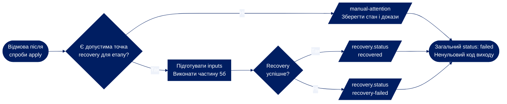

### 5б. Відновлення й перевірка попереднього образу

Перехоплена помилка чи переривання будь-якого кроку частини 5б повертає
`recovery-failed` у 5а; підготовка inputs також належить до цієї спроби recovery.

## 6. Підписаний HTTP-запит — UML-послідовність

Джерела: `Deployment.request`, `health` та SigV4 у `aws.py`.
Час у UML-послідовності йде згори вниз. Локальні деталі згруповано, щоб зменшити
висоту. STS identity перевіряється на межі операції. Кожен запит перевіряє API,
єдиний `$default` маршрут із `AWS_IAM` та точну Lambda-інтеграцію.
HTTP-докази можуть містити дані застосунку; credentials не журналюються.

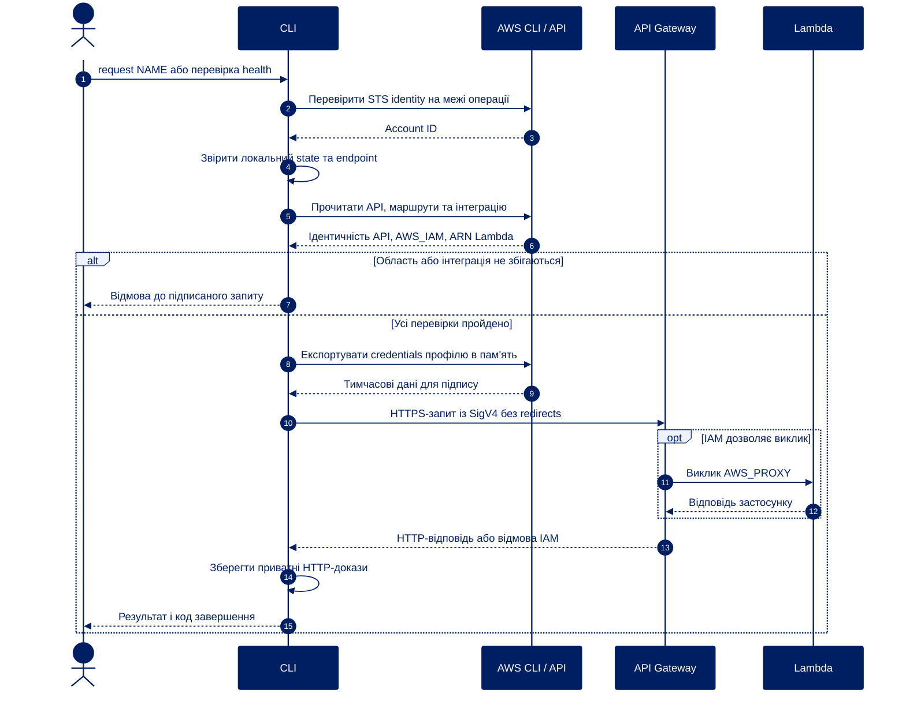

Якщо IAM відмовляє, Lambda не викликається. `health()` повторює неуспішну
HTTP-відповідь до шести разів із паузою 2 с між спробами; мережевий виняток може
припинити перевірку раніше. Ліміти: JSON-об’єкт POST до 64 KiB, відповідь до 1 MiB.

## 7. Придатність збереженого плану — UML-стани

Це концептуальна модель перевірок `reviewed` і маркера `applied.json`,
а не окреме поле стану в програмі. У `review.json` зв'язано account, region,
образ, попередню Lambda та хеші source/settings/state/файлів плану.
Неправильний SHA-256, введений оператором, відхиляє виклик і не змінює сам план.

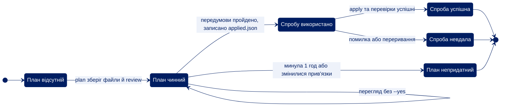

## 8. Залежності модулів — структурна UML-модель

Класифікатори `module` позначають Python-модулі. Пунктирна стрілка
спрямована від залежного модуля до його залежності. Модель показує основні
реальні імпорти; підписи містять назви файлів для зіставлення з кодом.
Прикладні модулі не імпортують `main.py`.

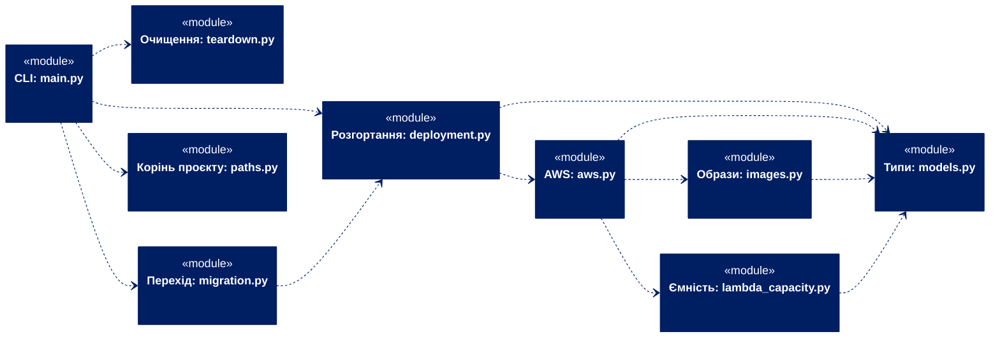

## 9. Ресурси AWS — структурна UML-модель

Класифікатори `service` позначають логічні ресурси. Це структурна модель,
а не порядок виконання Terraform. Суцільна стрілка — взаємодія, пунктирна —
залежність. Функція отримує право GetObject/PutObject у бакеті даних;
фактичний доступ залежить від workload. Додатковий бакет access logs використовує
SSE-S3. DLQ застосовується до невдалих асинхронних Lambda-викликів, а не до
синхронних HTTP-помилок.

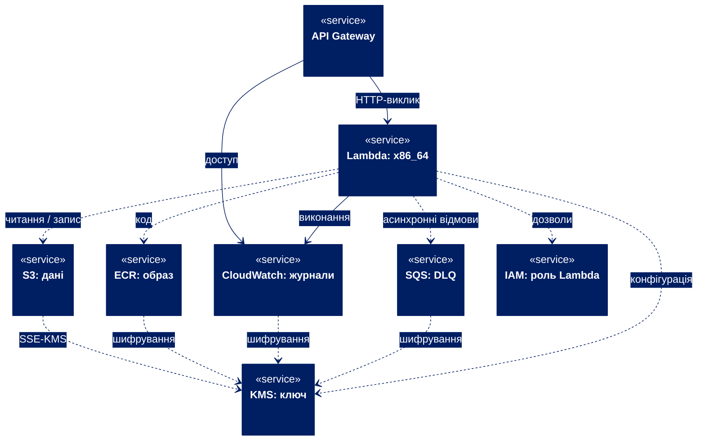

## 10. Очищення власного S3-бакета

Джерела: `main.cleanup`, `bucket_plan`, `bucket_purge` у `teardown.py`.
Маніфест має власну схему 1, строк дії одну годину та точні version/upload IDs.
Погодження видалення вимагає `--acknowledge-backup`; перевіряються SHA-256,
account/region/bucket, purpose, формат і повний актуальний інвентар.
Частини 10а і 10б виконуються в одному lock розгортання. Перед очищенням
оператор резервує потрібні дані та зупиняє записувачів.

### 10а. Область дії та вибір операції

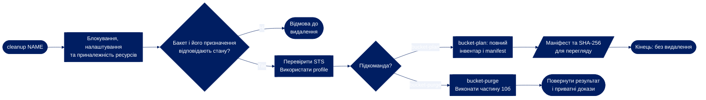

### 10б. Перевірка погодження та точне видалення

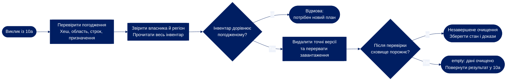

Відмова власника/регіону, неправильний manifest, помилка API чи часткове
видалення зупиняють операцію. Наявні версії та delete markers видаляються
пакетами до 1000 записів; uploads перериваються окремо. Cleanup не видаляє
бакет, ECR, KMS або Terraform state.

## 11. Явний локальний перехід попереднього стану

Джерело: `migration.migrate`. Ця сумісність зберігає керування вже наявними
ресурсами. Окремого старого режиму CLI немає. Обидві частини виконуються
локально, під одним lock старого каталогу, без звернень до AWS.

### 11а. Перевірка та перегляд переходу

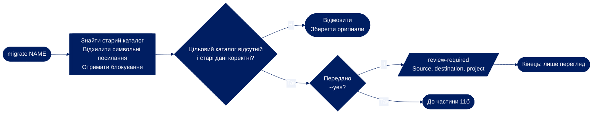

### 11б. Збереження налаштувань і переміщення

```mermaid
%%{init: {"theme":"base","themeVariables":{"primaryColor":"#001E62","primaryTextColor":"#FFFFFF","primaryBorderColor":"#001E62","lineColor":"#001E62","textColor":"#001E62","secondaryColor":"#EEF2FA","secondaryTextColor":"#001E62","secondaryBorderColor":"#001E62","tertiaryColor":"#EEF2FA","tertiaryTextColor":"#001E62","tertiaryBorderColor":"#001E62","edgeLabelBackground":"#EEF2FA","labelBackgroundColor":"#EEF2FA"},"themeCSS":".edgeLabel, .edgeLabel p, .edgeLabel span { color: #001E62 !important; fill: #001E62 !important; } .edgeLabel, .labelBkg { background-color: #EEF2FA !important; }"}}%%
flowchart LR
    S(["Із частини 11а"])
    BACKUP["Зберегти settings.v1.json<br/>Копію не перезаписувати"]
    UPDATE["Записати settings схеми 2<br/>Зберегти старе призначення"]
    MOVE["Перемістити каталог<br/>до deployments/NAME"]
    OK{"Переміщення<br/>успішне?"}
    RESTORE["Якщо джерело існує:<br/>відновити старі settings"]
    ERROR(["Помилка переходу<br/>Резервну копію збережено"])
    DONE(["migrated<br/>Створити новий план"])
    S --> BACKUP --> UPDATE --> MOVE --> OK
    OK -->|Ні: OSError| RESTORE --> ERROR
    OK -->|Так| DONE
```

State та імена ресурсів зберігаються. Старі плани після переходу непридатні.
Помилка запису backup до оновлення settings зупиняє перехід. OSError під час
оновлення settings або переміщення обробляється спробою відновлення старих
settings, якщо каталог джерела ще існує. Backup залишається для ручного аналізу.
